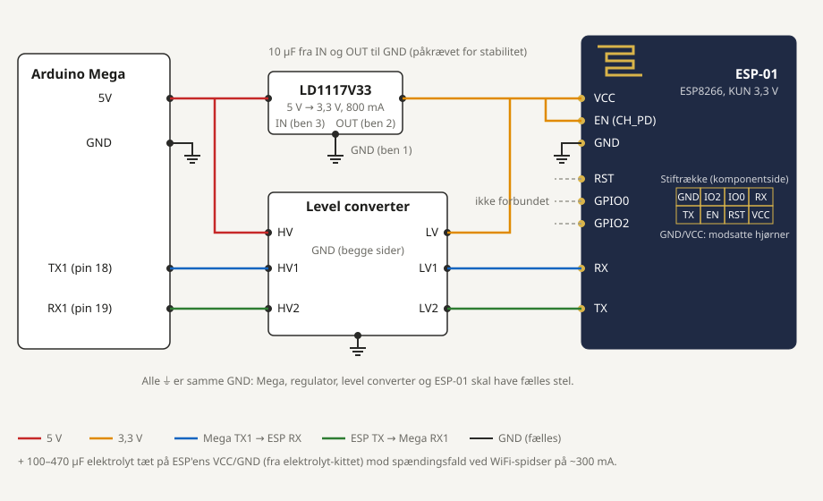

# ESP-01 (ESP8266) til Arduino Mega

Købt: 1 stk, Ardustore, 14-05-2024, 25 kr. Ser ud til aldrig at være brugt. En ChatGPT-opsummering af V1 siger, at "Arduino WiFi-delen blev droppet pga. hardwareproblemer", men du har selv kaldt den opsummering forkert, så tag det med forbehold.
Datablade: [`../datasheets/esp8266ex.pdf`](../datasheets/esp8266ex.pdf) (chippen) og
[`../datasheets/esp8266-at-commands.pdf`](../datasheets/esp8266-at-commands.pdf) (AT-kommandoerne).

ESP-01 er en selvstændig mikrocontroller med WiFi. Fra fabrikken kører den **AT-firmware**: Arduinoen sender
tekstkommandoer over seriel (UART), og modulet svarer `OK`/`ERROR`. Den kan også programmeres direkte
(se [Alternativ](#alternativ-programmér-esp-01-direkte)).

## Pinout

```
   ┌──────────────────────┐
   │  ~~antenne~~         │   Set fra komponentsiden (chippen opad).
   │                      │   GND og VCC sidder i hver sit diagonale hjørne,
   │  GND  IO2  IO0  RX   │   TX ved siden af GND, RX ved siden af VCC.
   │  TX   EN   RST  VCC  │   Tjek med multimeter: GND er forbundet til printets store stelflade.
   └──────────────────────┘
```

| Pin | Funktion | Forbind til |
|---|---|---|
| VCC | Forsyning **3,3 V** (maks 3,6 V). Strømspidser op til ~300 mA ved WiFi-sending | LD1117V33 OUT |
| GND | Stel | Fælles GND |
| EN (CH_PD) | Chip enable. Skal være høj, ellers sker der intet | 3,3 V (direkte eller via 10 kΩ) |
| RST | Reset, aktiv lav | Lad den være, eller 10 kΩ til 3,3 V |
| GPIO0 | Høj = normal opstart, lav = flash-tilstand | Ikke forbundet ved normal brug |
| GPIO2 | Skal være høj ved opstart | Ikke forbundet |
| TX | ESP sender (3,3 V-signal) | Level converter LV2 → HV2 → Mega RX1 (pin 19) |
| RX | ESP modtager. **Tåler ikke 5 V** | Level converter LV1 ← HV1 ← Mega TX1 (pin 18) |

## Forbindelsesdiagram



Alt hertil har du i forvejen (se `../INVENTORY.md`):

- **3,3 V:** `ld1117-33` (LD1117V33) fra Megaens 5V-pin. Set forfra med benene ned: 1 = GND, 2 = OUT, 3 = IN.
  Den skal have **10 µF fra IN til GND og fra OUT til GND**, ellers kan den svinge (står i ST-databladet). Sæt
  også **100–470 µF** tæt på ESP'ens VCC/GND. Begge kondensatorer findes i `elektrolyt-kit`.
  `breadboard-psu` (MB102, 3,3 V-skinnen) kan bruges i stedet, når du prøver på breadboard.
- **Niveauskift:** `level-converter` (4 kanaler, BSS138). HV = 5 V, LV = 3,3 V, GND på begge sider.
  To kanaler bruges: Mega TX1 → ESP RX og ESP TX → Mega RX1.
- **Seriel port:** Megaens `Serial1` (pin 18/19). `Serial` (USB) beholdes til Serial Monitor.

> **Brug ikke Megaens egen 3,3V-pin.** Den er kun beregnet til 50–150 mA (afhænger af boardet) og falder
> sammen, når ESP'en sender. Det er den mest almindelige grund til, at ESP-01 genstarter tilfældigt eller ikke
> svarer. Det kan også være forklaringen på "hardwareproblemerne" i V1.

Modstandsdeler i stedet for level converter (kun Mega TX → ESP RX): 1 kΩ fra pin 18 til ESP RX og 2 kΩ fra
ESP RX til GND giver 3,33 V. ESP TX → Mega RX1 kan gå direkte, fordi Megaen læser 3,3 V som høj. Der står
ingen modstandssæt i komponentlisten, så level converteren er det nemme valg.

## Kode

Begge sketches er til Arduino Mega og kompilerer med AVR-core 1.8.8.

1. **[`esp01_passthrough/`](esp01_passthrough/esp01_passthrough.ino)** — kør denne først. Den prøver 115200,
   9600, 57600 og 74880 baud og fortæller, hvilken modulet svarer på. Derefter kan du skrive AT-kommandoer i
   Serial Monitor (115200 baud, linjeskift **"Both NL & CR"**).
2. **[`esp01_webserver/`](esp01_webserver/esp01_webserver.ino)** — forbinder til dit WiFi, skriver IP-adressen
   i Serial Monitor og viser en side med oppetid og værdien på A0. Kopiér først `secrets.h.example` til
   `secrets.h` og udfyld netnavn og kodeord. ESP-01 kan kun bruge **2,4 GHz**-net.

Nyttige AT-kommandoer (fuld liste i `esp8266-at-commands.pdf`):

| Kommando | Gør |
|---|---|
| `AT` | Svarer `OK`, hvis forbindelsen virker |
| `AT+GMR` | Firmwareversion |
| `AT+RST` | Genstarter modulet |
| `AT+CWMODE=1` | Station-tilstand (forbinder til et eksisterende net) |
| `AT+CWLAP` | Scanner efter WiFi-net |
| `AT+CWJAP="net","kode"` | Forbinder til et net |
| `AT+CIFSR` | Viser IP-adressen |
| `AT+UART_DEF=115200,8,1,0,0` | Sætter baudraten permanent (nyere firmware; ældre bruger `AT+CIOBAUD`) |

## Fejlsøgning

| Symptom | Sandsynlig årsag |
|---|---|
| Intet svar ved nogen baudrate | EN ikke høj, TX/RX byttet om, ingen fælles GND |
| Volapyk i Serial Monitor | Forkert baudrate. Ved opstart sender ESP'en altid lidt volapyk ved 74880 baud, og det er normalt |
| Svarer, men genstarter ved `AT+CWJAP` | Forsyningen falder sammen: større kondensator, kortere ledninger, rigtig 3,3 V-regulator |
| `FAIL` ved `AT+CWJAP` | Forkert kodeord eller et 5 GHz-net |
| Modulet bliver meget varmt | Det har fået 5 V. Det er sandsynligvis ødelagt |

## Alternativ: programmér ESP-01 direkte

ESP8266 er kraftigere end Megaen og kan køre Arduino-kode selv (core: *esp8266 by ESP8266 Community*). Det
kræver en USB-seriel-adapter på 3,3 V og GPIO0 til GND under upload. Der er kun 2 frie GPIO, så modulet egner
sig bedst som WiFi-bro. **I SENNEP V2 er det nok smartere at lade Pi 5 klare WiFi** og droppe ESP-01 i robotten.

## Kilder

- [ESP-01 og ESP-01S, DCC-EX](https://dcc-ex.com/reference/hardware/wifi-boards/esp-01.html) — forbindelser til Mega og advarslen om 3,3 V-strøm
- [ESP8266 pinout reference, Random Nerd Tutorials](https://randomnerdtutorials.com/esp8266-pinout-reference-gpios/) — opstartspins (GPIO0/2)
- Espressif: ESP8266EX-datablad og AT Instruction Set (lokale kopier i `../datasheets/`)
