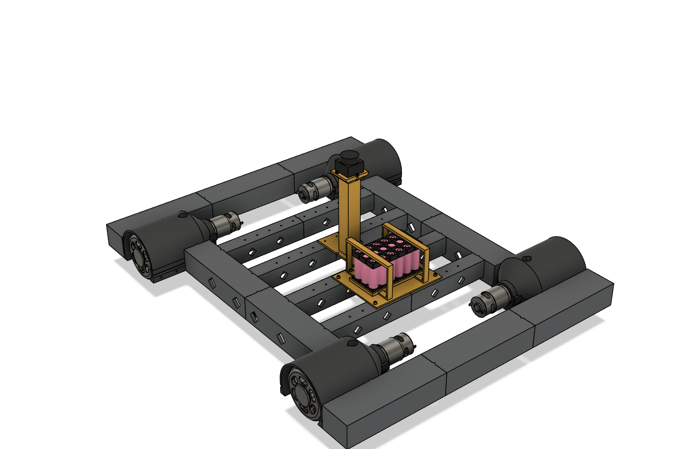

# SENNEP V2

A hobby omni-wheel (mecanum) robot built by Mikkel, almost entirely 3D-printed, that is meant to drive itself with a 360° LiDAR and be driven by hand over radio. It is a rebuild of the high-school robot S.E.N.N.E.P. for fun and learning.

## Where things stand (October 2026)
| Area | State |
|---|---|
| Wheel | v3.1 printed set + assembly ring, waiting for a test assembly → [wheel.md](wheel.md) |
| Corner housing | v2 printed set, waiting for test → [chassis.md](chassis.md) |
| Frame | Ladder frame modelled, joint test print ready → [chassis.md](chassis.md) |
| Body | v0 visual shell, not split into panels → [chassis.md](chassis.md) |
| Battery | 3S6P groups built, series connections not made → [motor-and-power.md](motor-and-power.md) |
| Electronics | Parts bought, no wiring or PCB yet → [`components/`](../components/README.md) |
| Software | LiDAR test app only (`Lidar Test Enviornment/`); no robot code |

The live feature list is [`ai-instructions/FEATURES.md`](../ai-instructions/FEATURES.md).

## Docs
| Doc | Contents |
|---|---|
| [requirements.md](requirements.md) | Requirements, sensors, Pi / Arduino architecture |
| [wheel.md](wheel.md) | Printed mecanum wheel: design, assembly, history |
| [chassis.md](chassis.md) | Corner housing, ladder frame, body, fastener BOM |
| [motor-and-power.md](motor-and-power.md) | Motor datasheet, load estimate, drivers, battery, power tree |
| [printing-lessons.md](printing-lessons.md) | Fits, overhang, strength: what test prints taught |
| [fusion-scripting.md](fusion-scripting.md) | How the Fusion generators work, MCP usage, pitfalls |
| [history.md](history.md) | V1, the 2025 timeline, old models, sources |

Other places: `components/` (parts list, datasheets), `print/` (STL sets with Danish print guides), `fusion/` (generators), `docs/skelet/` (screenshots).

## Cost
About **6,840 kr** is documented in receipts (Ardustore, Hobby Components, Bot'n Roll, AliExpress), excluding shipping. The Pi 5, LiDAR, motors and filament have no receipt. Per-part prices are in `components/INVENTORY.md`.
