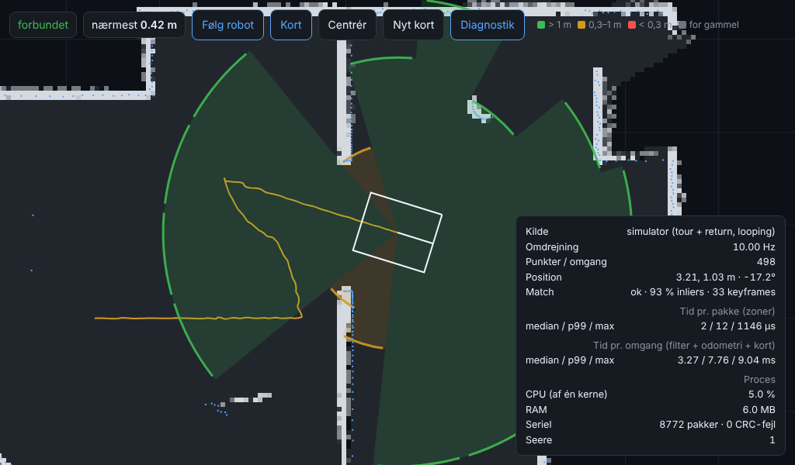

# LiDAR stack v2 — plan

Status (2026-10-12): **approved and v1 built** in Rust (`lidar/`, see `lidar/README.md`). All four
steps from round 2 are done and tested against recordings + simulator; results in §10 and `BENCHMARK.md`.
**Not** tested on the real LiDAR or the Pi yet.
The old app (`Lidar Test Enviornment/`) is only used as inspiration and test data.

---

## 1. Status: what the old app did, and why it stuttered

The old Electron + Next.js app (Gemini, ~3300 lines of JS) ran: serial parser → sweep buffer →
PreFilter → Downsampler → OutlierRemoval → ICP → "SensorFusion" (stub) → WallExtractor/WallTracker →
OccupancyGrid → MovingObjectDetector → IPC to a React canvas.

**Measurements on the recordings** (3 files, 122 sweeps ≈ 12 s, all static, the LiDAR stood still on a table;
median distance ~30 cm, max ~2 m):

| Measurement | Result | Meaning |
|---|---|---|
| Noise per degree over time | median **1.5 mm** STD, p90 5 mm | The sensor is calm. The stutter came from the software |
| Points per sweep | alternates **492 / 504** | Sweeps are cut at packet boundaries → the seam jumps |
| Sweep start | 7.85° → 1.52°, then 2.25° → 5.19° | Every other sweep covers >360° (duplicate points at the seam) |
| Rate | 10.0 Hz, 3600 °/s, ~5040 pts/s | As the datasheet |
| File 3 | p90 STD 409 mm at some angles | Something moved (good test of "moving objects") |

**Root causes of jitter and bugs (found in the code):**

1. **No proper scan assembly.** A new sweep is started when a *packet's* start angle drops >50°, so
   sweeps alternately overlap/miss a few degrees. LDROBOT's own SDK splits at *point* level at 360→0.
2. **Timestamps are ignored.** The packet's ms timestamp (wraps at 30000) is not used; no receive time.
   Without time you cannot de-skew (correct for the robot's movement during the 100 ms one revolution takes)
   or fuse with the IMU.
3. **The map ignores the position.** `OccupancyGrid.update()` gets a pose, but does not use it
   (comment: "Pipeline will pre-transform" — it never does). As soon as the robot moves, the map becomes wrong.
4. **ICP is frame-to-frame, point-to-point, without an initial guess** (and off by default). Errors add
   up (drift), and there is no map to match against.
5. **Walls are derived from a polar profile in the sensor's own frame** with EMA smoothing → only works when
   the robot stands still, and EMA gives lag/"swimming". Then *yet another* layer of EMA in WallTracker.
6. **Only processes every 2nd sweep** (`updateRate: 2`) and sends the whole map as JS objects over IPC
   every time → heavy and stuttering in the UI.
7. **Mirroring likely:** LD19 angles increase *clockwise* (left-handed system, manual §4), but
   the code uses `cos/sin(angle − 90°)` as if they increased counter-clockwise.
8. Many tuning layers (AutoTuner, CalibrationRunner) that adjust parameters while running → not deterministic.
9. Electron + Next.js dev server: ~300–500 MB RAM just for the UI. Too heavy for the Pi.

**Lessons for v2:** assemble scans correctly, timestamp everything, one shared coordinate system (robot frame →
world frame via pose), match against a map (not only the previous scan), no magic EMA layers, deterministic
and testable, the UI separate from the processing.

## 2. Facts about the sensor (datasheet + manual in `components/datasheets/`)

- UART 230400 8N1, TX only (one-way). 3.3 V logic. ~420 packets/s × 47 B ≈ **20 kB/s** (trivial).
- Packet: `0x54 0x2C`, speed (°/s), start angle (0.01°), 12 × (distance mm u16, intensity u8),
  end angle, timestamp (ms, wraps 30000), CRC8 (poly 0x4D, table in the manual).
- Angle per point = linear interpolation start→end, with wrap (`(end + 36000 − start) % 36000`).
- 10 Hz (6–13 Hz via PWM), 5000 measurements/s (STL-19P) → ~500 points/revolution, 0.72° resolution.
- Range 0.03–12 m (white), 8 m (black). Accuracy: STD 2 mm < 0.5 m, 4 mm < 2 m, 15 mm > 2 m.
- Pitch error up to 2° → at 3 m the beam hits ±10 cm in height (relevant for low obstacles).
- Left-handed: 0° = the sensor's front, angle increases clockwise. We convert to the ROS convention
  (x forward, y left, angle counter-clockwise) once in the parser.
- LDROBOT's SDK has a "near filter" for the LD19 (zeroes small groups < 5 m with low intensity) — a good idea to copy.

## 3. Research — short

**Scan matching / odometry.** The robot deliberately has **no wheel encoders** (mecanum slips anyway),
so LiDAR (+ MPU-6050 gyro) is the only source of odometry. That makes scan matching the core.
- *Point-to-point ICP* (old app): simple, but converges slowly and fails at large rotations.
- *Point-to-line ICP (PL-ICP, Censi 2008)*: converges quadratically on indoor walls, the standard in CSM.
- *Correlative scan matching (Olson 2009, used in Cartographer/Karto)*: brute-force search in a
  probability map at coarse+fine resolution → robust against a bad initial guess. Good for "catching" before ICP refines.
- *Scan-to-map instead of scan-to-scan* (the Hector SLAM principle): matches against a local map → much less drift.
- *Full SLAM with loop closure* (slam_toolbox, Cartographer): needed for large maps; overkill for v1 of a home/workshop.
- KISS-ICP is built for 3D and not an obvious fit for 2D.

**Map:** log-odds occupancy grid (int8/float32 NumPy array, e.g. 5 cm cells, 20×20 m = 160 k cells = 160 kB).
Ray casting vectorised in NumPy or via Bresenham in Numba.

**ROS 2 or not:** ROS 2 Jazzy runs on the Pi 5 with slam_toolbox (LDROBOT has an official ROS 2 driver),
but an IEEE comparison (2026, Pi 5) and forum posts show that it can run, not that it is easy:
DDS, colcon, launch files, TF tree, Ubuntu instead of Raspberry Pi OS. The project has already decided
"Python from scratch — NO ROS2" (PROJECT_OVERVIEW §3).

**Language:** The amount of data is small (500 points × 10 Hz). Python + NumPy is plenty if you work
on whole arrays and avoid Python loops per point. Measurement in this session: KD tree (SciPy) built +
lookup for 500 points ≈ 0.5 ms on an x86 cloud CPU; Pi 5 (Cortex-A76, ~1.5–2× Pi 4) expected ~1–1.5 ms.
Rust/C++ gives 10–50× on loops, but costs build time and learning curve. Both can be combined: Python
everywhere, and only a hot loop is moved out if measurements show the need.

**Visualisation:**
- *Own web UI served from the Pi* (one HTML file + Canvas/WebGL, WebSocket with binary frames):
  ~0 % CPU on the Pi apart from sending ~10 kB/frame; works from PC, phone and the 7" screen (Chromium kiosk).
- *Foxglove* (`foxglove-sdk` 0.29, has aarch64 wheels, Python ≥ 3.10): excellent dev tool with
  plots, 3D, recording to MCAP, without ROS. Needs the Foxglove app on the PC.
- *Rerun*: lovely for development, but a heavier viewer and less suited to running on the robot's screen.

**Budget on the Pi 5** (4× A76 @ 2.4 GHz; RAM unknown, 4 or 8 GB). The LiDAR stack must share the machine
with camera/AI, the motor control link and the UI, so targets:

| Target | Requirement |
|---|---|
| Processing per revolution (median / p99) | ≤ 10 ms / ≤ 25 ms (i.e. ≤ 10–25 % of one core) |
| Latency: last point in revolution → result sent | ≤ 30 ms p99 |
| Obstacle detection per packet (not per revolution) | ≤ 2 ms |
| RAM (RSS) | ≤ 150 MB |
| Stability, static robot | pose jitter ≤ 5 mm / 0.2°; walls move ≤ 1 cm frame to frame |

## 4. Architecture proposal

Common to all: the sensor sits behind a `ScanSource` interface with three implementations —
`SerialSource` (real LiDAR), `ReplaySource` (recordings, incl. the old JSONL) and `SimSource`
(synthetic room + known driving path, generates *raw LD19 bytes*, so the parser is tested too). A new recorder
stores **raw bytes + receive time** in a compact binary format, so future recordings can be replayed bit for bit.

```
 ScanSource ──bytes──▶ Parser (CRC, angles, time) ──packets──▶ ┬─▶ Safety zones (per packet, fast)
 (Serial/Replay/Sim)                                           └─▶ Scan assembler (360°, point level, deskew)
                                                                         │ Scan (NumPy, robot frame)
                                                                         ▼
                                                        Filter (near filter, intensity, own body)
                                                                         ▼
                                                  Odometry: correlative → PL-ICP against local map (+ gyro)
                                                                         ▼
                                                    Occupancy grid ─▶ (later) loop closure / localisation
                                                                         ▼
                                               Publisher ──WebSocket (binary)──▶ Web UI / Foxglove / recorder
```

### Option A — Python + NumPy, one process, own web UI (**recommended**)
- `asyncio` process: reads serial in a thread, processing in the main loop, `aiohttp`/`websockets` for the UI.
- Dependencies: `numpy`, `scipy` (KD tree), `pyserial`, `websockets`. Optional `numba` for ray casting.
- UI: one static HTML/JS file (no build step), Canvas 2D: points, map, pose, path, zones, diagnostics.
- Foxglove bridge as an optional module for development (same data, other channels).
- **+** Matches the project decision (Python, no ROS), easy for Mikkel to read/change, same code on PC and Pi,
  tests in `pytest`. **−** Python loops are slow → needs discipline (vectorisation). GIL: one core.

### Option B — Rust core + web UI
- One static binary (`serialport`, `nalgebra`, `tokio-tungstenite`), cross-compiled to aarch64.
- **+** Fastest and smallest (≈ 5–10 MB RAM, < 2 % CPU), no GIL, robust.
  **−** New language world, longer iterations, harder to experiment with algorithms; the rest of the robot is Python.

### Option C — ROS 2 Jazzy + ldlidar_stl_ros2 + slam_toolbox + Foxglove
- **+** Proven SLAM with loop closure "for free", RViz/Foxglove, Nav2 later.
  **−** Goes against the existing decision, heavy (Ubuntu, DDS, ~1 GB+ RAM in total), a lot of "magic",
  harder to understand why things go wrong — and the learning ("built from scratch") disappears.

### Recommendation
**A**, with clear interfaces so a hot loop can be moved to Numba/Rust *if* benchmarks on the Pi
show the need. It is the fastest way to reach "stable and measurable", and it fits the rest of the robot.

## 5. Build order (milestones, each with tests)

| # | Milestone | "Done" means |
|---|---|---|
| M0 | Repo skeleton, `ScanSource`, parser, CRC, binary recording format, JSONL import, simulator | Parser tests against the manual's example packet; sim → parser → same points |
| M1 | Scan assembler + filters + frame conversion | Always one scan per revolution, no overlap/gaps at the seam; static jitter measured |
| M2 | Web UI (live points + diagnostics) | Runs on PC against replay; < 5 % CPU for the server part |
| M3 | Safety zones / obstacles | Latency per packet measured; correct zones in sim |
| M4 | Odometry (scan-to-local-map, correlative + PL-ICP) | Sim: drift < 2 % of distance driven, < 1°/revolution around; static: jitter < 5 mm |
| M5 | Occupancy grid + map in the UI | Map in sim matches ground truth (IoU), stable in static replay |
| M6 | Moving objects, save/load map, localisation, loop closure | According to Mikkel's priorities |

A benchmark script (`bench`) runs all recordings + sim and reports median/p99 latency, CPU time and RSS
— so "fast and stable" is measured, not claimed. Can be run on the Pi unchanged.

## 6. What is Foxglove, and where does it fit in?

Foxglove is a free desktop/browser program for *looking at robot data*: you connect to a
WebSocket on the robot and get panels with 2D/3D views of point clouds and maps, graphs over time
(e.g. latency, gyro), tables with raw messages and playback of recordings (MCAP files) with a timeline.
It is made for ROS, but works without ROS: the program on the Pi just sends data in Foxglove's format.

Here it would be a **developer tool on the PC**, not the robot's UI: when scan matching behaves
strangely, you can scrub back and forth and plot errors over time without us building those tools ourselves.
We build the robot's own display (browser + 7" screen) ourselves, light and specialised. The Foxglove bridge is
optional and can come later (M2+); there is a Rust version of `foxglove-sdk`.

## 7. Decisions

### Round 1 (2026-10-12)
- **Language:** preferably **not Python**. Speed/CPU matters most, because the Pi must also run camera/AI and other things.
  C or Rust preferred; the choice is left to Claude. (The Mega link session postponed the Pi language until
  the LiDAR decision and made a language-neutral C99 protocol core.)
  → Option A (Python) is **rejected**. New recommendation: **Option B, Rust** (reasons in §8).
- **First feature:** obstacles/safety zones.
- **UI:** browser over WiFi + the robot's 7" screen (same web page). Foxglove explained in §6.
- **"It works" =** a stable picture when the robot stands still, a map that holds when it drives,
  and the robot can be controlled from it (data on to the motor control).
  Note: "a map that holds" needs odometry + occupancy grid (M4–M5), so they belong in v1 —
  just after the safety zones.

## 8. Rust over C — reasons

| | Rust | C |
|---|---|---|
| Speed | Same as C (LLVM, no GC) | Same |
| Memory errors (buffer overflow, use-after-free, data races) | Caught by the compiler | Caught only when the robot crashes |
| Threads (serial reader, processing, web server) | Safe via the type system | Manual with mutex; a classic source of bugs |
| Web server + WebSocket for the UI | Ready-made libraries (`tungstenite`, `tiny_http`) | Must be bound to e.g. mongoose/libwebsockets |
| Tests + benchmarks | Built in (`cargo test`, `cargo bench`) | Home-made / external framework |
| Cross-compiling to Pi 5 (aarch64) | `cargo build --target aarch64-unknown-linux-gnu` or build directly on the Pi | gcc-cross, Makefile |
| Reuse of the Mega link's C99 core | Via FFI (`cc` crate) or a ~100-line Rust port of COBS+CRC-16 | Directly |
| Learning curve | Steep (ownership/borrow checker) | Low to start, high to make robust |

Conclusion: Rust gives C's speed without C's crash classes, and has the ecosystem a web UI and tests need.
The downside is the learning curve. The C core from the Mega link can be used as is via FFI.

**Honest note about camera AI:** the Raspberry Pi AI Camera (IMX500) runs the neural network *on the
camera sensor itself*; the Pi only receives the results. Face recognition therefore costs far less CPU
on the Pi than you would think — but it does not change the choice, because Rust is also the best for the rest.

### Round 2 (2026-10-12) — plan approved
- **Language: Rust** for the whole Pi application (the Mega link's C99 core can be used via FFI or ported).
- **Obstacles:** the Pi sends "nearest distance per sector" to the Mega (~20–50 Hz); the Mega limits
  speed/stops together with ToF (the reflex architecture in `docs/electronics/PI_MEGA_LINK.md`, branch
  `claude/stoic-cray-tsomgg`). In v1 the zones sit behind an interface; the link encoding itself is done when the link is built.
- **Order approved:** (1) parser + scan assembly + simulator + tests → (2) web UI with a stable
  live picture → (3) safety zones → (4) LiDAR odometry + a map that holds when the robot drives.
- **Connection:** the USB adapter from the kit (CP2102), found via `/dev/serial/by-id/…`; the port is a setting.

## 9. Final architecture (v1)

One Rust binary `sennep-lidar` (folder `lidar/`), no runtime dependencies:

| Module | Responsibility |
|---|---|
| `protocol` | Streaming parser for LD19 packets: resync, CRC8, angle wrap, no allocation per packet |
| `source` | `ByteSource` trait: `SerialSource`, `ReplaySource` (raw `.ldr` + old `.jsonl`, re-encoded to packets), `SimSource` |
| `clock` | Maps the LiDAR's ms clock (wrap 30000) to the host's monotonic time |
| `scan` | Scan assembler at point level (split at 360→0), robot frame (x forward, y left, counter-clockwise), time per point |
| `filter` | Range, LDROBOT-like near filter, mask for the robot's own body |
| `zones` | Sector distances from the robot's edge (rectangle), updated **per packet** |
| `odom` | Scan-to-local-map: constant-velocity prediction → de-skew → point-to-line ICP (Gauss-Newton, Huber) against keyframes |
| `grid` | Log-odds occupancy grid (5 cm), ray casting, dirty tiles sent incrementally |
| `sim` | Synthetic room + path + noise from the datasheet → **raw LD19 bytes** (tests the whole chain) |
| `server` | HTTP (one static page) + WebSocket with binary frames; clients always get the newest frame (no queue) |
| `bench` | Replays recordings + sim, measures latency, CPU, RSS, jitter, drift, map IoU → `docs/lidar/BENCHMARK.md` |

## 10. Status after v1 (2026-10-12)



Measured in the cloud (x86, ~1.5–2.5× faster per core than the Pi 5) — full table in `BENCHMARK.md`:

| Target (§3) | Requirement | Measured |
|---|---|---|
| Processing per revolution, median / p99 | ≤ 10 / ≤ 25 ms | 2.9 / 7.2 ms (Pi estimate ~5–7 / ~15 ms) |
| Zones per packet | ≤ 2 ms | < 1 µs median, p99 2 µs |
| CPU | ≤ 10–25 % of one core | 2–3.4 % (incl. web server: 5–6 % with sim) |
| RAM | ≤ 150 MB | ~6 MB for the whole program |
| Static jitter | ≤ 5 mm / 0.2° | 0.25–0.7 mm / 0.07–0.09° (recordings), 1.4 mm / 0.04° (sim, 15 mm noise) |
| Map that holds | — | 8.7 m trip: 0.02 % drift, 99 % precision; 173 m (11 min): 2.6 mm / 0.01° back at the start, 92 % precision |
| Zones correct | — | 0 optimistic errors in 4800 sector values with a walking person |

Important findings along the way: the sensor now and then overlaps two packets by 0.2° (also at the seam) — harmless;
thin things far away are not hit every revolution (physics, not a bug); a zone is up to one revolution (100 ms)
old, which during rotation means a thing can "change sector" between two passes; thick walls require
ICP to reject the back side (normals oriented towards the sensor); keyframes must be reused when the robot comes
back, otherwise the heading drifts ~4° in 11 minutes.

**Next steps (proposal):**
1. Mikkel: run `sennep-lidar --serial …` + `bench` on the Pi with the real LiDAR; record a few trips with `--record`.
2. Check the mounting: that the LiDAR's 0° points forward (otherwise `Mount.yaw`) and that the robot's outline fits.
3. Send `ZoneReport` over the Pi↔Mega link when it is built (`ObstacleSink`).
4. Fuse the gyro (MPU-6050 via the Mega) into the prediction → robust in fast turns.
5. Save/load map + localisation in a saved map; then moving objects.

## 11. Walls, objects and movement (2026-10-12)

Asked by Mikkel after the first real test: walls as solid lines (the old app's lines "jumped all over"),
walls vs objects, and movement — not person recognition: "movement is enough", for collision paths, attention
and as 360° backup for the camera that will follow people.

**Why the old lines jumped:** they were fitted to each revolution and thrown away 0.1 s later. Now:
- **Walls (`walls.rs`)** are fitted to the occupancy grid, which already averages hundreds of revolutions at
  corrected poses. Every 0.5 s the known walls are re-fitted first (to the cells near them), then RANSAC finds new
  ones in the rest. Ids persist; the line is smoothed, growth along the wall is taken at once, shrinking is
  smoothed; corners are joined with hysteresis so they cannot flicker. Cells hugging a wall (the staircase of a
  diagonal wall) belong to the wall. Everything else solid = **objects** (convex outlines).
- **Movement (`motion.rs`)**: a point is moving if it lands in a cell the map has seen free many times
  (≤ −40 log-odds ≈ 8 beams) with nothing solid within 10 cm. Moving points never become map hits. Points are
  grouped (35 cm: two legs = one thing) and tracked with a constant-velocity Kalman filter per axis. A track is
  shown after 3 detections **and 25 cm of travel**; unseen tracks keep predicting for 2 s ("lost").

**Results:**
| Test | Result |
|---|---|
| Mikkel's room (`lidar/recordings/2026-10-12_room_walkthrough.ldr`, LiDAR at chest height, he walks in at 11 s) | 0 false movers before; tracked in 80/80 scans while walking; one id the whole time; 0.5–1.0 m/s |
| Same recording, walls after the first 5 s | worst end change 37 mm (one end cell), lines hold to mm |
| Simulated robot driving 2 × 8.7 m, nobody there | 0 ghost movers in 639 scans (before the 25 cm rule: 13 % of scans, all at door frames) |
| Simulated person, robot driving | 252/252 track positions within 30 cm of the person |
| Simulated flat, walls | every wall point within 75 mm of a real wall; 30 of 47 m found (the rest not seen on the tour) |
| Cost | walls ~0.5–1 ms per update (2 Hz); whole revolution 1.3–3.9 ms median on x86 |

**Next (ideas, in the hub):** collision prediction (a mover's path vs the robot's planned path), hand-over
with the AI camera (camera says "that is the person I follow", LiDAR keeps the track 360°), stopping "lost"
predictions at walls, gyro in the odometry.

### 11b. Second recording: sprints and bending down (2026-10-12)

`lidar/recordings/2026-10-12_room_2.ldr` (+ `.txt`): Mikkel walks in, stands still 22 s, sprints three times to
the far wall and back, bends down to fix the carpet. **Sprint speed** (raw detections, not the filter): peak
3.3–3.6 m/s over 0.4 s (12–13 km/h), 3.0–3.2 m/s over 0.6 s; the dash is only ~3.3 m long.

First version lost the id at each sprint turn (the filter assumed gentle acceleration and the prediction ran
through the wall) and after bending down (2.4 s below the scan plane, coast was 2 s). Now: acceleration σ 5 m/s²,
gate 0.8 m + 0.3 s × speed, a lost track slows down (τ 0.5 s) and stays within 1 m of where it was seen, coasts
3 s, and a detection within 1.2 m of a lost track takes over its id. Result: **one id for the whole 80 s**,
seen in 180/180 scans while standing still, tracker top speed 3.6 m/s (test `room_2_sprints_and_bending_down_keep_one_id`).

Recording is now done from the page (`recording.rs`): live LiDAR records automatically into `recordings/auto/`;
Keep / Mark / Stop / Start buttons.
